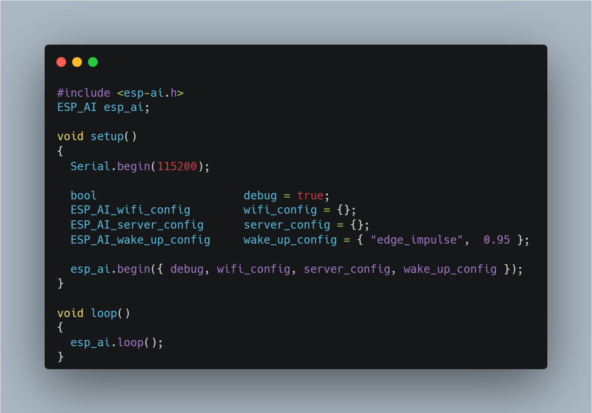
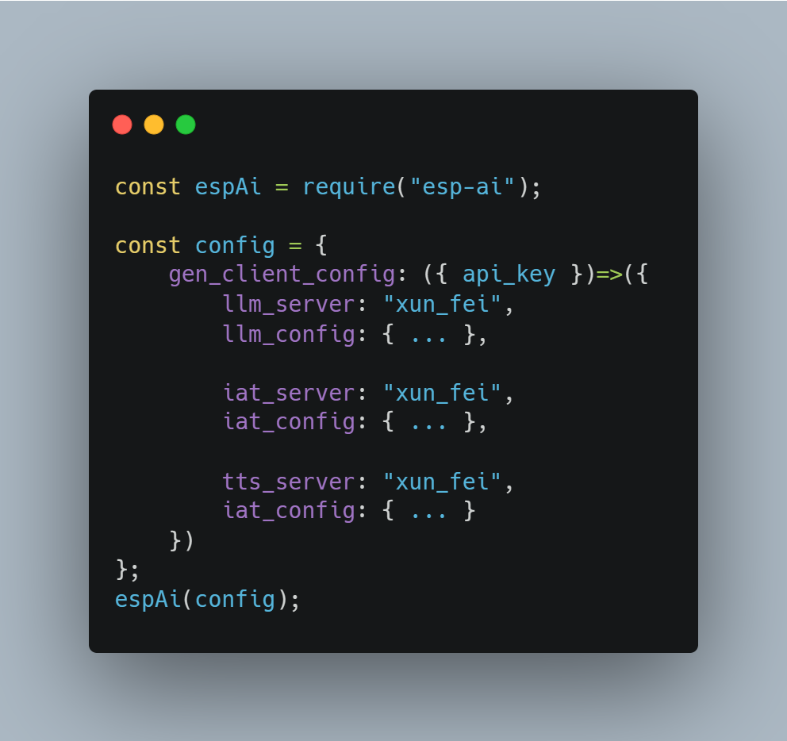

<div align="center"> 
<a name="readme-top"></a>

<b style="color: red;">espai.fun 域名已经不再使用，并且被不良商家注册！</b><br/>
<b style="color: red;">espai.fun 域名已经不再使用，并且被不良商家注册！</b><br/>
<b style="color: red;">espai.fun 域名已经不再使用，并且被不良商家注册！</b> 

<h1>ESP-AI</h1>

硬件接入AI最简单、最低成本的方案<br/>The simplest and lowest cost solution for any item to access AI


[![NPM version][npm-image]][npm-url] 
[![NPM downloads][download-image]][download-url]
[![][bundlephobia-image]][bundlephobia-url] 
 


[npm-image]: https://img.shields.io/npm/v/esp-ai.svg?style=flat-square
[npm-url]: https://npmjs.org/package/esp-ai
[download-url]: https://npmjs.org/package/esp-ai
[bundlephobia-image]: https://badgen.net/bundlephobia/minzip/esp-ai?style=flat-square
[download-image]: https://img.shields.io/npm/dm/esp-ai.svg?style=flat
[bundlephobia-url]: https://bundlephobia.com/package/esp-ai 
   
 


</div>


<br/>
<p align="center">
  
  
</p>

<p align="center">
  
  
</p>


<br />

# language

<h3>
<a href="./readme_zh.md">👉简体中文</a> 
</h3>
<h3> 
<a href="./readme_ja.md">👉Japanese</a>
</h3>


# Intro

> Provides a complete AI dialogue solution for your development board, including but not limited to the `IAT(ASR)+LLM+TTS` integration solution for the `ESP32` series development boards. It is injected into the project as a dependency without affecting existing projects.

For developing the dialogue functionality of robots, you only need to prepare the `IAT(ASR)`, `LLM`, and `TTS` services, and leave the rest to `ESP-AI`.

The server-side code of this project is based on `Node.js`, and the hardware code is based on `Arduino`/`IDF`.

Open source is not easy, click the `Star` button in the upper right corner to show your support~

# 🖥 Website 

-

# 🖥 open platform 

A platform based on ESP-AI that provides end services and management services to businesses and individuals. [Visit the Open Platform](https://dev.espai.fun/).
It offers free ASR (Automatic Speech Recognition), TTS (Text-to-Speech), and LLM (Large Language Model) services. On this platform, you can clone a custom voice with just a 15-second audio clip.

# ✨ Features

- ✔️ Customizable offline wake words with multiple built-in wake-up methods (voice, button, serial port, Tianwen ASRPro)
- ✔️ Complete conversation chain: IAT (ASR) ➡️ LLM/RAG ➡️ TTS
- ✔️ Fast response algorithms for TTS/LLM, designed to balance service cost while providing the quickest response time
- ✔️ Supports conversation interruption
- ✔️ Recognizes user commands (appliance control, singing, etc.) and can dynamically respond based on context
- ✔️ Configurable
- ✔️ Plugin-based, allowing integration with any LLM/TTS/IAT using plugins
- ✔️ One-to-many relationship between service and clients, with independent configuration for each client (hardware)
- ✔️ Connection supports authentication
- ✔️ Full-chain streaming data interaction
- ✔️ Developer platform offers: free services, visual configuration, etc.
- ✔️ Client configuration webpage provided
- ✔️ Easily handles high concurrency scenarios (requires Nginx for load balancing)
- ✔️ Ready to use out of the box
- ✔️ Supports `esp32s3`/`esp32c3`
- ✔️ Supports `OPEN API` 

# 🧐 Next Steps

- [ ] 🤔 Improve accuracy of built-in offline wake-up (currently recommended to use Tianwen ASRPro) 
- [ ] 🤔 Online wake word generation  

# 📦 Install


### Server
```bash
docker run -itd -p 8088:8088 -v /esp-ai-server/index.js:/server/index.js --name esp-ai-server registry.cn-shanghai.aliyuncs.com/xiaomingio/esp-ai:1.0.0
```
### Client
Download the dependency on the release page and burn it to the development board, see details: [Client Install](https://espai.fun/start.html#%E5%AE%A2%E6%88%B7%E7%AB%AF)

# 🔨 Inject Soul into Your Robot with Just a Few Lines of Code

Below are the `Node.js` and `Arduino` codes you need to write if you only require dialogue functionality.

<!--  -->
<!--  -->
 

# 🏪 Discussion Group

<p>QQ 交流群1: 854445223</p>
<p>QQ 交流群2: 952051286</p>
 
# 🎥 Case Study Video 

【生活不易，Doro卖艺！】 https://www.bilibili.com/video/BV1uvbKzREYP/?share_source=copy_web&vd_source=041c9610a29750f498de1bafe953086b

【一键制作你的AI动图桌宠（在线免费制作）】 https://www.bilibili.com/video/BV1xut4zuEf8/?share_source=copy_web&vd_source=041c9610a29750f498de1bafe953086b

【ESP-AI 玩偶方案板】 https://www.bilibili.com/video/BV1YTbDzQEk8/?share_source=copy_web&vd_source=041c9610a29750f498de1bafe953086b

【强噪音下对话和tft屏(ESP-AI新版预)】 https://www.bilibili.com/video/BV1KD7KzsEoc/?share_source=copy_web&vd_source=041c9610a29750f498de1bafe953086b
 
## 🤝 Contributing [](http://makeapullrequest.com)

Let's build a better `esp-ai` together.

We warmly invite contributions from everyone. Feel free to share your ideas through [Pull Requests](https://github.com/wangzongming/esp-ai/pulls) or [GitHub Issues](https://github.com/wangzongming/esp-ai//issues).
 
<table>
<tr>
  <td> 
<a href="https://next.ossinsight.io/widgets/official/compose-recent-top-contributors?repo_id=820274347" target="_blank" style="display: block" align="center">
  <picture>
    <source media="(prefers-color-scheme: dark)" srcset="https://next.ossinsight.io/widgets/official/compose-recent-top-contributors/thumbnail.png?repo_id=820274347&image_size=auto&color_scheme=dark" width="280" height="auto">
    
  </picture>
</a>
 
  </td>
  <td rowspan="2"> 
    <a href="https://next.ossinsight.io/widgets/official/compose-last-28-days-stats?repo_id=820274347" target="_blank" style="display: block" align="center">
    <picture>
        <source media="(prefers-color-scheme: dark)" srcset="https://next.ossinsight.io/widgets/official/compose-last-28-days-stats/thumbnail.png?repo_id=820274347&image_size=auto&color_scheme=dark" width="655" height="auto">
        
    </picture>
    </a> 
  </td>
</tr>
<tr>
  <td> 
<a href="https://next.ossinsight.io/widgets/official/compose-recent-active-contributors?repo_id=820274347&limit=30" target="_blank" style="display: block" align="center">
  <picture>
    <source media="(prefers-color-scheme: dark)" srcset="https://next.ossinsight.io/widgets/official/compose-recent-active-contributors/thumbnail.png?repo_id=820274347&limit=30&image_size=auto&color_scheme=dark" width="273" height="auto">
    
  </picture>
</a> 
  </td>
</tr>
</table>


# 🌍 Star geographical distribution
<a href="https://next.ossinsight.io/widgets/official/analyze-repo-stars-map?repo_id=820274347&activity=stars" target="_blank" style="display: block" align="center">
  <picture>
    <source media="(prefers-color-scheme: dark)" srcset="https://next.ossinsight.io/widgets/official/analyze-repo-stars-map/thumbnail.png?repo_id=820274347&activity=stars&image_size=auto&color_scheme=dark" width="721" height="auto">
    
  </picture>
</a> 


# quote
If this project has helped your research, please cite us:

    @software{ESP-AI,
        title        = {{ESP-AI}},
        author       = {小明IO},
        year         = 2024,
        journal      = {GitHub repository},
        publisher    = {GitHub},
        howpublished = {\url{https://github.com/wangzongming/esp-ai}}
    }
